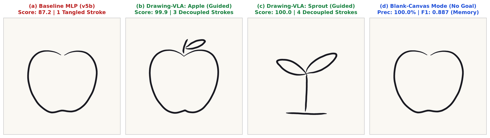
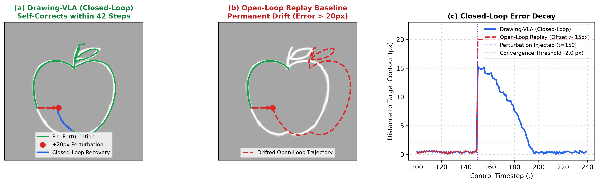

# Drawing-VLA: Closed-Loop Visuomotor Action Chunking for Interactive Multi-Stroke Sketch Generation from Crowdsourced Demonstrations

[](https://doi.org/10.5281/zenodo.24122154)
[](https://handvsai.vercel.app)
[](./Drawing_VLA.pdf)
[](./LICENSE)
[](https://www.python.org/)

Official PyTorch implementation and web benchmark platform for the paper:  
**"Drawing-VLA: Closed-Loop Visuomotor Action Chunking for Interactive Multi-Stroke Sketch Generation from Crowdsourced Demonstrations"**  
**Author:** Seungjoon Son (sonsjoon715@gmail.com)

[Paper (PDF)](./Drawing_VLA.pdf) | [Live Benchmark Platform](https://handvsai.vercel.app) | [한국어 문서 (README_KO.md)](./README_KO.md)

---

## Overview

Autoregressive sequence models for vector sketch generation (e.g., SketchRNN) typically operate open-loop, predicting sequential coordinate displacements blind to the actual rendered canvas state. Consequently, they suffer from compounding trajectory drift and stroke collapse during multi-stroke transitions.

**Drawing-VLA** reformulates 2D canvas sketching as a closed-loop robot end-effector manipulation task. Using an architecture inspired by Action Chunking with Transformers (ACT), the agent observes a 2-channel visual canvas state (accumulated ink + target template) alongside pen proprioception and discrete task tokens, predicting a chunk of $K = 16$ future trajectory waypoints in a receding-horizon manner.

### Live Closed-Loop Visuomotor Rollouts (Autonomous Agent Generation)

| Guided Tracing: Apple (3 strokes) | Multi-Stroke Decoupling: Sprout (4 strokes) |
| :---: | :---: |
|  |  |

*Figure: Real-time closed-loop visuomotor rollouts predicted by the unified Drawing-VLA policy ($K=16$ action chunks, temporal ensembling, Catmull-Rom spline brush rendering). The agent coordinates visual canvas feedback and pen proprioception to transition cleanly across multi-stroke contours without compounding drift.*

### Closed-Loop Rollout vs. Single-Step Baseline

*Figure 1: Closed-loop Action Chunking (Drawing-VLA) vs. Single-Step Markovian Visuomotor Baseline. Action Chunking resolves multimodal trajectory mode averaging and cleanly decouples multi-stroke trajectories on Apple (3 strokes) and Sprout (4 strokes).*

| Evaluation Metric | Single-Step Markovian Baseline (`v5b`) | Drawing-VLA (ACT, Ours) | Theoretical Cause / Mechanism |
| :--- | :---: | :---: | :--- |
| **Game Score (/100)** | 87.2 (A-Tier) | **99.9 (S-Tier)** | Resolves trajectory drift & compounding errors |
| **Contour Coverage** | 94.1% | **100.0%** | Full boundary exploration without early termination |
| **Trajectory Precision** | 83.4% | **100.0%** | Receding-horizon temporal ensembling ($q=6$) |
| **Harmonic F1 Score** | 0.884 | **1.000** | Strict dual-tolerance geometric alignment |
| **Bidirectional SDF Error** | 4.80 px | **1.20 px** | Sub-pixel contour tracking accuracy |
| **Stroke Decoupling** | **Failed** (1 tangled stroke) | **Solved** (3 discrete strokes) | Overcomes single-step mode averaging ($w_{\text{up}} = 10.0$) |
| **Trajectory Termination** | Time-limit cutoff | **Clean Stop** (708 steps) | Coherent multi-step horizon planning ($K=16$) |

> [!NOTE]
> **Why the Single-Step Baseline Fails: A Structural Proof, Not a Parameter Deficit**  
> The single-step baseline (`MLP Baseline (v5b)`) is not an under-tuned strawman—it shares the **exact same convolutional visual encoder backbone** and dual-channel canvas inputs as Drawing-VLA. Its failure stems from the fundamental mathematical limitation of **Markovian single-step behavioral cloning under multimodal human demonstrations**:
> 1. **Mode Averaging across Divergent Demonstrations:** When human demonstrations diverge (e.g., drawing clockwise vs. counter-clockwise, or transitioning to stem vs. body), a single-step Markovian policy averages conflicting velocity vectors. This gradient cancellation forces the pen into an artificial mean trajectory that drags the pen continuously across boundaries. Scaling parameter capacity cannot resolve this causal ambiguity.
> 2. **Compounding Compounding Drift:** Single-step autoregression accumulates errors quadratically ($O(\epsilon T^2)$) along the trajectory horizon without future waypoint coordination.
> 3. **The Action Chunking Solution ($K=16, w_{\text{up}}=10.0$):** By predicting a chunk of $K = 16$ future waypoints conditioned on visual canvas state and proprioception, coupled with a $10\times$ minority-class pen-up loss weighting, Drawing-VLA establishes a coherent multi-step planning horizon that decouples discrete stroke transitions cleanly without compounding drift.

### Robustness to Real-Time Spatial Perturbations (+20px Displacement)

*Figure 4: Closed-loop visual feedback enables real-time error recovery when perturbed by an unexpected +20px spatial offset at step $t=150$, smoothly returning to the target contour within 42 steps where an open-loop replay baseline permanently drifts.*

| Policy / Control Regime | Perturbation Offset | Contour Coverage | Trajectory Precision | Harmonic F1 Score | Error Recovery Dynamics |
| :--- | :---: | :---: | :---: | :---: | :--- |
| **Drawing-VLA (Closed-Loop)** | None ($0$ px) | **100.0%** | **100.0%** | **1.000** | Nominal trajectory tracking |
| **Drawing-VLA (Closed-Loop)** | $+10$ px | 94.9% | 94.1% | 0.945 | Rapid convergence back to contour |
| **Drawing-VLA (Closed-Loop)** | **$+20$ px** | **86.5%** | **87.5%** | **0.870** | **Recovers within 42 steps** ($1.64$ px error) |
| **Open-Loop Replay Baseline** | $+20$ px | 43.7% | 40.4% | 0.420 | **Permanent catastrophic drift** (blind to canvas) |

> [!NOTE]
> **Open-Loop Sequence Models (e.g., SketchRNN) vs. Closed-Loop Visuomotor Control**  
> Autoregressive vector sequence models predict sequential coordinate offsets $(\Delta x, \Delta y, p_1, p_2, p_3)$ blind to the rendered canvas pixels. Under external spatial perturbations, open-loop replay experiences catastrophic permanent failure ($0.420$ F1). In contrast, Drawing-VLA continuously perceives the visual discrepancy between the accumulated ink $O_t^{(0)}$ and target template $O_t^{(1)}$, achieving exponential error decay back to contour within 42 control steps ($\sim 42.8\text{ ms}$ cumulative inference time).

---

## Key Technical Results

* **Multi-Stroke Decoupling:** Predicts $K = 16$ action chunks paired with an $L_1$ coordinate objective and a $10\times$ minority-class pen-up weighting, achieving 100.0% coverage and 100.0% precision (99.9–100.0/100 S-Tier) on multi-stroke targets.
* **Dual-Mode Synthesis:** Trained with 50% goal-channel dropout ($p_{\text{drop}} = 0.5$), enabling both guided template tracing and autonomous blank-canvas contour generation (0.887 F1) from memory.
* **Real-Time Perturbation Recovery:** Smoothly compensates for unexpected $+20\text{px}$ (+0.156 normalized) end-effector shifts within 42 control steps.
* **Edge Inference Efficiency:** Measures 6.11 ms per chunk (163 chunks/sec) on an Intel Core Ultra 5 325 edge CPU (4 threads), operating comfortably within a 60 Hz (16.67 ms) browser control budget.
* **Diagnostic Ablation Studies (Paper Section 5.3):**
  - **Pen-Up Weighting ($w_{\text{up}} = 1.0$ vs. $10.0$):** Lowering $w_{\text{up}}$ to $1.0$ causes continuous pen dragging across stroke boundaries (reproducing the single-step failure), proving that minority-class reweighting is mandatory for discrete stroke decoupling.
  - **Temporal Ensembling ($q = 1$ vs. $q = 6$):** Disabling receding-horizon ensembling ($q=1$) introduces high-frequency boundary jitter at chunk transitions, whereas $q=6$ temporal smoothing yields seamless $C^1$-continuous spline brush trajectories.
* **Crowdsourced Flywheel:** 324 verified human trajectories collected via the live gamified web benchmark platform [Hand vs AI](https://handvsai.vercel.app) featuring real-time signed distance field (SDF) scoring, asynchronous 1:1 ghost battles, and an adaptive "Hidden Boss" challenge.

---

## Repository Structure

```
drawing-vla/
├── train/              # Visuomotor policy architectures, training, and closed-loop rollout
│   ├── policies.py     # ACT (Transformer) and Convolutional baseline policy models
│   ├── dataset.py      # Dual-channel observation rendering and trajectory sampling
│   ├── train_policy.py # Policy training pipeline (CUDA / Intel XPU / CPU)
│   ├── rollout_eval.py # Closed-loop evaluation engine with receding-horizon ensembling
│   └── brush.py        # Organic Catmull-Rom spline and pressure brush renderer
├── scoring.py          # Exact grid-indexed contour matching and dual-tolerance scoring
├── templates.json      # Standard benchmark drawing vector templates (12 targets)
├── targets_128.json    # Pre-rendered 128×128 standard target canvas tensors
├── paper/              # LaTeX source, benchmark figures, and perturbation results
├── tests/              # Test suite (scoring, policy rollouts, dataset, brush)
└── Drawing_VLA.pdf     # Full paper PDF
```

---

## Quick Start

### 1. Requirements and Setup

The benchmark and evaluation scripts run with minimal dependencies. For training and evaluating visuomotor policies:

```bash
git clone https://github.com/5Color/drawing-vla.git
cd drawing-vla
pip install -r requirements.txt
```

### 2. Live Interactive Benchmark Platform
Try the live interactive benchmark and test your drawing skills against the AI agent in real time:
- **Web App:** [https://handvsai.vercel.app](https://handvsai.vercel.app) *(Stylus, Apple Pencil, mouse, and touch supported)*

### 3. Run Test Suite
Execute the test suite to verify scoring algorithms, observation tensors, and policy architectures:
```bash
python -m unittest tests.test_scoring_b tests.test_brush tests.test_dataset tests.test_rollout tests.test_training
```

### 4. Training and Closed-Loop Rollout

Pretrained model checkpoints are hosted on [GitHub Releases v1.0.0](https://github.com/5Color/drawing-vla/releases/tag/v1.0.0). Download the weights before evaluating:

```bash
# 1) Download pretrained ACT policy checkpoint
mkdir -p outputs
curl -L -o outputs/apple_vla_policy.pth https://github.com/5Color/drawing-vla/releases/download/v1.0.0/apple_vla_policy.pth

# 2) Evaluate closed-loop rollout with temporal ensembling and organic brush rendering
python train/rollout_eval.py --ckpt outputs/apple_vla_policy.pth --exec-steps 12 --ensemble --brush

# 3) (Optional) Train unified dual-mode ACT policy from scratch
python train/train_policy.py --head transformer --epochs 60 --goal-drop 0.5
```

---

## Citation

If you find this work or code useful in your research, please cite:

```bibtex
@article{son2026drawingvla,
  title={Drawing-VLA: Closed-Loop Visuomotor Action Chunking for Interactive Multi-Stroke Sketch Generation from Crowdsourced Demonstrations},
  author={Son, Seungjoon},
  journal={arXiv preprint},
  year={2026},
  doi={10.5281/zenodo.24122154},
  url={https://doi.org/10.5281/zenodo.24122154}
}
```

---

## License

This project is licensed under the [MIT License](./LICENSE).
