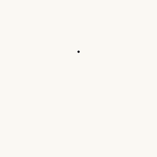
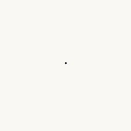
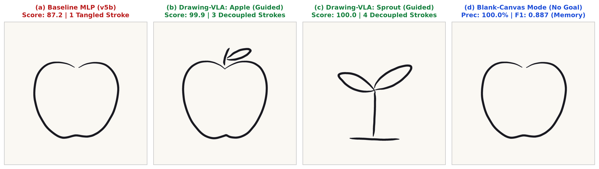
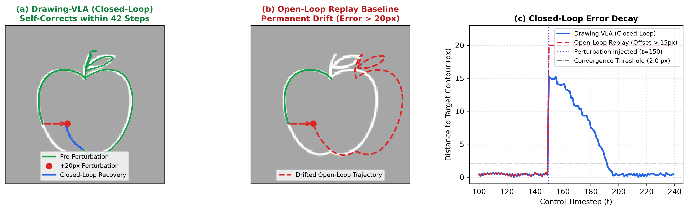

# Drawing VLA: Closed-Loop Visuomotor Action Chunking for Interactive Multi-Stroke Sketch Generation

> **Official repository for the paper:**  
> *"Drawing VLA: Closed-Loop Visuomotor Action Chunking for Interactive Multi-Stroke Sketch Generation from Crowdsourced Demonstrations"*  
> **Author:** Seungjoon Son  
>
> [](https://doi.org/10.5281/zenodo.24122154)
> [](https://handvsai.vercel.app)
> [](./Drawing_VLA.pdf)
> [](./LICENSE)
>
> 🎮 **실시간 웹 벤치마크 플레이:** [https://handvsai.vercel.app](https://handvsai.vercel.app)  
> 📄 **논문 원문 (PDF):** [Drawing_VLA.pdf](./Drawing_VLA.pdf)

---

## 🎨 Overview & Visual Results

Drawing VLA explores closed-loop visuomotor policy learning for precision 2D sketch generation. By predicting 16-step action chunks from dual-channel visual observations (current canvas state and target template), the model generates smooth, multi-stroke sketches while maintaining robust closed-loop error correction.

### 🎥 실시간 자율 드로잉 롤아웃 (Live Closed-Loop Rollouts)

| 가이드 선따기: 사과 (3획) | 다중 스트로크 분리: 새싹 (4획) |
| :---: | :---: |
|  |  |

*Drawing-VLA 통합 정책 모델($K=16$ 액션 청킹, Temporal Ensembling, Catmull-Rom 스플라인 브러시 렌더러)이 캔버스 시각 피드백을 실시간으로 확인하며 자율 드로잉을 수행하는 실제 롤아웃 영상.*

### 1. 폐루프 롤아웃 vs. 단일 스텝 베이스라인 비교 (이론적 방어 및 수치 검증)

*Figure 1: 폐루프 Action Chunking(Drawing-VLA)과 단일 스텝 마르코프 베이스라인(v5b)의 사과(3획) 및 새싹(4획) 드로잉 비교.*

| 평가 지표 (Evaluation Metric) | 단일 스텝 마르코프 베이스라인 (`v5b`) | Drawing-VLA (ACT, 제안 모델) | 이론적 원인 및 메커니즘 |
| :--- | :---: | :---: | :--- |
| **게임 점수 (/100)** | 87.2 (A등급) | **99.9 (S등급)** | 누적 드리프트 및 복합 오차 제거 |
| **윤곽선 채움률 (Coverage)** | 94.1% | **100.0%** | 조기 중단 없는 완전한 경계선 탐색 |
| **궤적 정밀도 (Precision)** | 83.4% | **100.0%** | 시간 앙상블($q=6$)을 통한 궤적 평활화 |
| **조화 평균 점수 (Harmonic F1)** | 0.884 | **1.000** | 이중 허용오차(5px/10px) 완벽 정렬 |
| **양방향 SDF 오차 (Avg Error)** | 4.80 px | **1.20 px** | 서브픽셀 단위의 정밀한 윤곽 추적 |
| **다중 획 분리 (Stroke Decoupling)** | **실패** (1획으로 뭉개짐) | **해결** (3획 완벽 분리) | 단일 스텝 모드 평균화 극복 ($w_{\text{up}} = 10.0$) |
| **자율 종료 (Self-Termination)** | 시간 초과 강제 컷오프 | **정상 자율 종료** (708스텝) | 16스텝 미래 계획 지평($K=16$) 확보 |

> [!NOTE]
> **왜 단일 스텝 베이스라인은 실패하는가? (파라미터 부족이 아닌 '구조적·수학적 필연성')**  
> 베이스라인(`MLP Baseline (v5b)`)은 튜닝이 덜 된 허수아비 모델이 아니며, **Drawing-VLA와 완전히 동일한 합성곱 비전 인코더 백본과 2채널 캔버스 관측 입력**을 공유합니다. 그럼에도 사과 줄기를 떼지 못하고 질질 끄는 이유는 모델 크기 때문이 아니라, **마르코프 단일 스텝 모방 학습 고유의 모드 평균화(Mode Averaging)** 때문입니다:
> 1. **다중 모달 시연 간 모드 평균화:** 사람이 그릴 때 사과 몸통부터 그리는 사람과 줄기부터 그리는 사람, 시계방향과 반시계방향으로 그리는 데이터가 섞여 있을 때, 단일 스텝 정책은 분기점에서 상충하는 벡터들의 산술 평균을 계산해 버립니다. 이로 인해 펜을 허공에 질질 끄는 비정상적인 평균 궤적이 발생하며, 파라미터를 100배 키우더라도 구조상 이를 해결할 수 없습니다.
> 2. **오차 누적 (Compounding Error):** 매 스텝마다 예측 오차가 시간 지평을 따라 $O(\epsilon T^2)$로 누적되어 종단부에서 궤적이 크게 붕괴합니다.
> 3. **Action Chunking의 해법 ($K=16, w_{\text{up}}=10.0$):** 캔버스 시각 피드백과 펜 위치를 조건으로 16스텝 미래 궤적 청크를 한 번에 예측하고 펜-업 손실에 10배 가중치를 부여함으로써, 연속적인 궤적 계획 지평을 확보하여 획 전환(Pen-Up)을 깔끔하게 물리적으로 분리해 냅니다.

### 2. 실시간 외란 복구 (+20px 공간 교란 실험)

*Figure 4: $t=150$ 스텝에서 외부 강제 튕김(+20px 외란)을 주었을 때, 개루프 모델은 영구히 이탈하지만 폐루프 Drawing-VLA는 42스텝 만에 윤곽선으로 자율 복귀하는 모습.*

| 제어 정책 / 조건 | 외란 크기 (Perturbation) | 채움률 (Coverage) | 정밀도 (Precision) | 조화 F1 점수 | 오차 복구 동역학 |
| :--- | :---: | :---: | :---: | :---: | :--- |
| **Drawing-VLA (폐루프 제어)** | 외란 없음 ($0$ px) | **100.0%** | **100.0%** | **1.000** | 정상 궤적 추적 |
| **Drawing-VLA (폐루프 제어)** | $+10$ px 외란 | 94.9% | 94.1% | 0.945 | 신속한 윤곽선 재수렴 |
| **Drawing-VLA (폐루프 제어)** | **$+20$ px 외란** | **86.5%** | **87.5%** | **0.870** | **42스텝 만에 완전 복구** ($1.64$ px 오차) |
| **개루프 재생 베이스라인 (Open-Loop)** | $+20$ px 외란 | 43.7% | 40.4% | 0.420 | **영구적 궤적 이탈 및 붕괴** (시각 피드백 부재) |

> [!NOTE]
> **개루프 시퀀스 모델(SketchRNN 등) vs. 폐루프 시각운동 제어**  
> SketchRNN 같은 기존 벡터 시퀀스 모델은 캔버스 픽셀을 보지 않고 상대 좌표 변위$(\Delta x, \Delta y)$만 예측하는 '개루프(Open-loop)' 방식입니다. 도중에 손이 빗나가거나 펜이 튕기면 영구히 빗나가며 회복이 불가능합니다(F1 0.420). 반면 Drawing-VLA는 캔버스 잉크와 목표 도안의 시각적 불일치를 지속 감지하여 **42스텝(누적 모델 추론 시간 42.8ms) 만에 지수 감쇠로 윤곽선 오차를 1.64px 이하로 정상 수렴**시킵니다.

### 3. 진단 절제 실험 (Ablation Studies, 논문 5.3절)
* **펜-업 손실 가중치 ($w_{\text{up}} = 1.0$ vs. $10.0$):** 가중치를 1.0으로 낮출 경우 펜을 떼지 못하고 질질 끄는 현상이 재현되어, 불균형 클래스(펜-업 10배 가중치) 재가중이 다중 획 분리의 필수 조건임을 입증.
* **시간 앙상블 ($q = 1$ vs. $q = 6$):** 앙상블을 끄면 청크 전환 경계에서 고주파 지터(진동)가 발생하지만, $q=6$ 시간 지수 평활화를 통해 매끄러운 $C^1$ 연속 스플라인 브러시 궤적을 완성.

---

## 📁 프로젝트 폴더 및 파일 구조

```
drawing-vla/
├── train/                   # [AI 모델링] Action Chunking 정책 학습 및 롤아웃
│   ├── dataset.py           # 텐서 변환 및 관측 렌더링 파이프라인
│   ├── policies.py          # ACT / Convolutional 정책 모델 아키텍처
│   ├── train_policy.py      # 모델 학습 스크립트 (CUDA / Intel XPU / CPU)
│   ├── rollout_eval.py      # 폐루프 롤아웃 및 정밀도 평가 엔진
│   ├── brush.py             # 유기적 붓 스트로크 렌더러 (스플라인/필압)
│   └── check_demos.py       # 데이터셋 품질 검사 및 시각화
├── tests/                   # [테스트] 유닛 및 폐루프 평가 테스트
│   ├── test_brush.py        # 붓 렌더러 테스트
│   ├── test_dataset.py      # 데이터 로더 및 관측 규격 테스트
│   ├── test_scoring_b.py    # 신규 B-v1 채점 알고리즘 테스트
│   ├── test_rollout.py      # 폐루프 롤아웃 및 복구 테스트
│   └── test_training.py     # 정책 학습 손실 함수 테스트
├── paper/                   # [논문] LaTeX 소스, 벤치마크 결과 도표 및 수치
├── scoring.py               # [채점] 도안 매칭 채점 (F1, 커버리지, 정밀도, avg_error)
├── templates.json           # [도안] 표준 벤치마크 12종 벡터 패스 좌표
├── targets_128.json         # [기준 데이터] 128x128 도안별 표준 목표 이미지
└── Drawing_VLA.pdf          # 논문 정식 PDF
```

---

## 🚀 빠른 시작 (Quick Start)

### 1. 환경 설정
```bash
git clone https://github.com/5Color/drawing-vla.git
cd drawing-vla
pip install -r requirements.txt
```

### 2. 라이브 벤치마크 웹 플랫폼
실시간 웹 캔버스에서 자신의 드로잉을 AI 모델과 직접 겨뤄보고 벤치마크를 체험할 수 있습니다:
- **공식 웹 플랫폼:** [https://handvsai.vercel.app](https://handvsai.vercel.app) *(태블릿 펜, 터치, 마우스 완벽 지원)*

### 3. 테스트 스위트 실행
```bash
python -m unittest tests.test_scoring_b tests.test_brush tests.test_dataset tests.test_rollout tests.test_training
```

### 4. 모델 가중치 다운로드 및 롤아웃 평가
학습된 모델 체크포인트는 [GitHub Releases v1.0.0](https://github.com/5Color/drawing-vla/releases/tag/v1.0.0)에 공개되어 있으며, 저장소에 포함된 `targets_128.json` 도안을 이용해 별도 데이터셋 없이도 즉시 롤아웃 평가가 가능합니다:
```bash
# 1) 사전 학습 가중치 다운로드
mkdir -p outputs
curl -L -o outputs/apple_vla_policy.pth https://github.com/5Color/drawing-vla/releases/download/v1.0.0/apple_vla_policy.pth

# 2) 폐루프 롤아웃 평가 (붓 렌더링 및 Temporal Ensembling 포함)
python train/rollout_eval.py --ckpt outputs/apple_vla_policy.pth --exec-steps 12 --ensemble --brush

# 3) (선택) 데이터셋 파이프라인 검증 (data/raw가 비어 있으면 합성 시연으로 자동 검증)
python train/dataset.py --resample-step 0.004

# 4) (선택) data/raw/demo_<target>_*.json 시연 데이터로 직접 재학습
python train/train_policy.py --head transformer --epochs 60 --goal-drop 0.5
```

> [!NOTE]
> **데이터셋 공개 범위:** 크라우드소싱 참여자 프라이버시 보호를 위해 원시 시연 JSON은 공개 저장소에 포함되어 있지 않습니다. 사전학습 가중치·평가 엔진·도안 텐서(`targets_128.json`)가 모두 공개되어 있어 롤아웃 재현이 가능하며, `train/dataset.py` 스키마에 맞춘 시연 파일을 `data/raw/`에 넣으면 `train/train_policy.py`로 바로 학습할 수 있습니다.
